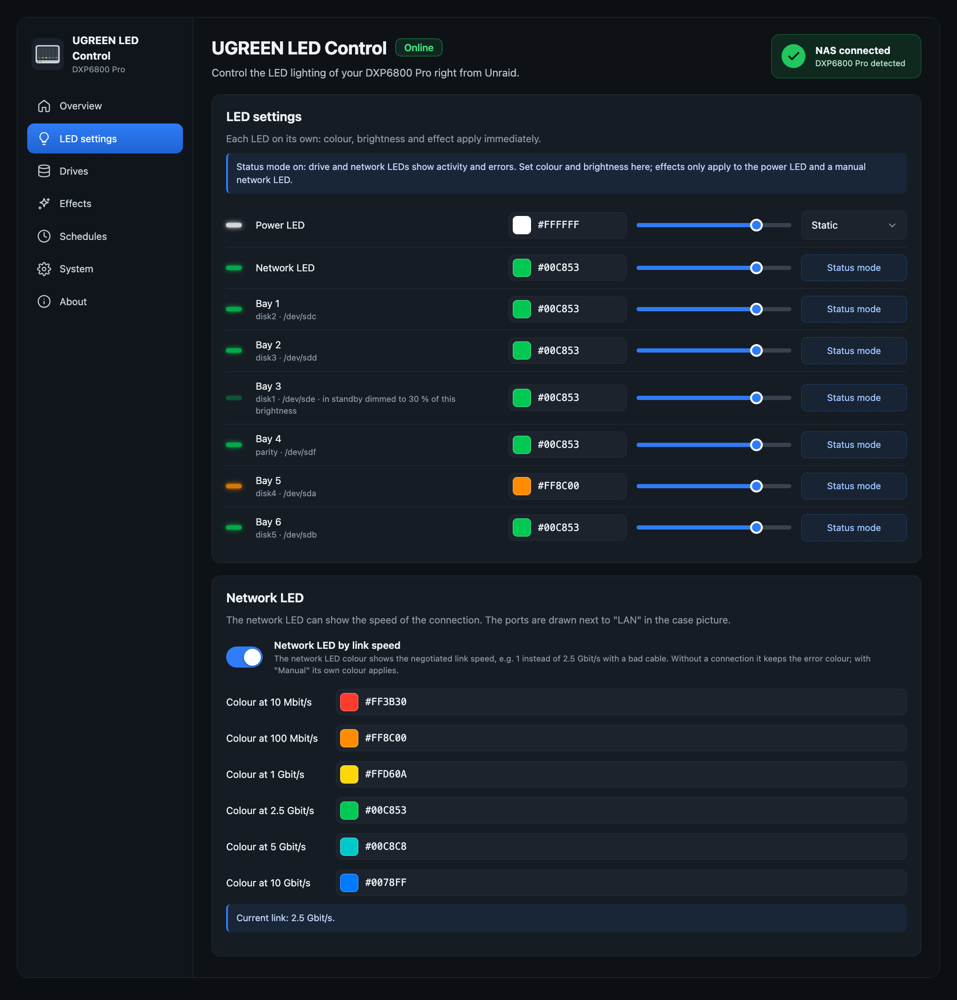
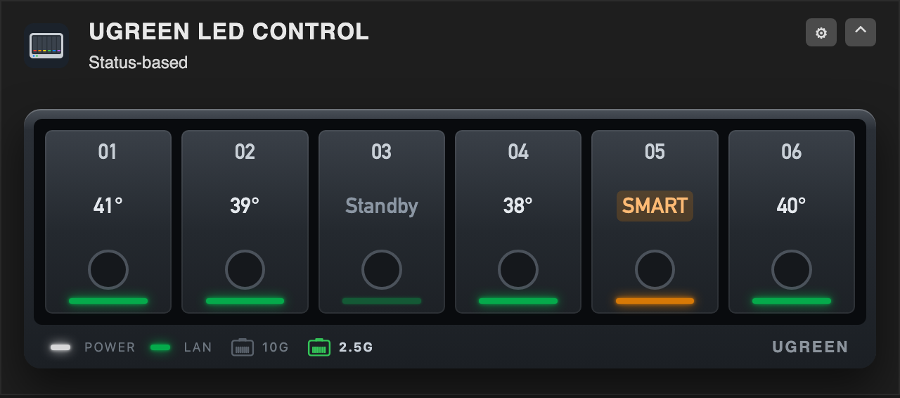

# UGREEN LED Control for Unraid

[](https://github.com/alexanderschubert/ugreen-led-control/releases/latest)
[)](https://github.com/alexanderschubert/ugreen-led-control/releases/latest)
[](https://github.com/alexanderschubert/ugreen-led-control/actions/workflows/i2c.yml)
[-f15a2c)](https://unraid.net)
[](LICENSE)
[](https://github.com/alexanderschubert/ugreen-led-control/stargazers)
[](https://github.com/alexanderschubert/ugreen-led-control/issues)
[](https://forums.unraid.net/topic/200791-plugin-ugreen-led-control-led-control-for-ugreen-dxdxp-nas/)

LED control for UGREEN DX/DXP NAS devices on Unraid 7: colour, brightness and effect for every front LED, and a status mode that turns the bay and network LEDs into a live view of your array. Developed on a DXP6800 Pro, confirmed by users on the DXP4800 family and the DXP8800 Plus.


## Features

- **Per LED**: colour, brightness and effect – static, breathe and pulse (run by the LED controller), rainbow and CPU temperature (run by the plugin, with speed, direction and "only when idle")
- **Status mode**: bay LEDs blink on disk activity, show an error colour for disabled or missing disks, warn on rising SMART values (with an "Acknowledge" button), breathe during parity checks and rebuilds, and dim, switch off or pulse slowly for spun-down disks. Each bay can show its disk's temperature colour, based on Unraid's warning and critical limits
- **Network LED**: blinks with traffic, shows only the link, or stays manual; optionally coloured by link speed (10 Mbit/s to 10 Gbit/s, one colour per speed), so a link that negotiated less than expected stands out. The network ports are also drawn next to the LAN LED in the case picture and the dashboard tile, as RJ45 sockets with the speed they run at, or dimmed with the speed they support when unplugged
- **Night mode**: dim or switch off at fixed times, also across midnight
- **Unraid alerts**: the power LED blinks while there are unread warnings or alerts
- **Shutdown and reboot**: the power LED blinks or breathes from the moment the array is stopped by a shutdown or reboot, in a colour you choose (with a test button)
- **Identify a bay**: blink one bay white before you pull a disk
- **Dashboard tile**: the live LEDs of every bay in a compact tile, optionally with temperatures
- **Interface**: English, German and Spanish; dark, light or "same as Unraid"; every setting saves on change and survives a reboot
- It never wakes sleeping disks and needs no kernel module




Dashboard tile, compact (the default) and with temperatures (Settings → System → Appearance → Dashboard tile):

<p>
  
  
</p>

The light colour scheme (System → Appearance → Colour scheme):


The screenshots show the interface with sample data of a DXP6800 Pro.

## Support

Questions and problems: the [support thread in the Unraid forum](https://forums.unraid.net/topic/200791-plugin-ugreen-led-control-led-control-for-ugreen-dxdxp-nas/). Bug reports and feature requests are also welcome as [GitHub issues](https://github.com/alexanderschubert/ugreen-led-control/issues). Please include your NAS model, the Unraid and plugin versions and the output of:

```
/usr/local/emhttp/plugins/ugreen-led-control/backend/ugreen-led-ctl status
/usr/local/emhttp/plugins/ugreen-led-control/backend/ugreen-led-ctl smbus
/usr/local/emhttp/plugins/ugreen-led-control/backend/ugreen-led-i2c probe
```

## Questions that come up

- **Bay LEDs don't blink, standby and link speed colours have no effect.** The default mode on the Overview must be **Status-based**; in **Manual** the LEDs only show the colours you set.
- **Switching on "by link speed" changes nothing.** The default colour of the network LED and the colour for 2.5G are both green. Check the line "Current link" under LED settings → Network LED and set the colour of that speed to something obvious.
- **The LEDs go dark when disks sleep.** That is the setting "Disks in standby" (System page); choose Dimmed, Normal, Off or Pulse slowly.
- **The LEDs on the RJ45 sockets stay lit when the NAS is off.** They belong to the network chip, not to the LED controller, and no software runs while the NAS is off, so the plugin can't change them. They usually stay lit because the port keeps its power for Wake-on-LAN: turn off the wake-up by LAN in the BIOS and, in Unraid, Wake-on-LAN for the port (`ethtool -s eth0 wol d`). You can't power on the NAS over the network afterwards.
- **Nothing is found on my model.** `/usr/local/emhttp/plugins/ugreen-led-control/backend/ugreen-led-i2c scan all` lists the I²C addresses that answer (it only reads); please post the output in the forum thread.

## Supported models

The LED controller (I2C address 0x3a on the SMBus I801 adapter, on the DXP4800 GT an AMD DesignWare I²C controller) is the same across UGREEN's DX/DXP series. Bays are matched to disks by SATA port, after [miskcoo/ugreen_leds_controller](https://github.com/miskcoo/ugreen_leds_controller):

| Model | Bays → SATA ports | Assignment |
|---|---|---|
| DXP6800 Pro | ata3, ata4, ata5, ata6, ata1, ata2 | verified (developed on it) |
| DXP8800 Plus | ata1 … ata8 | verified by miskcoo, confirmed by users |
| DXP4800 / Plus / Pro | ata1 … ata4 | confirmed by users |
| DX4600 Pro | ata1 … ata4 | verified by miskcoo |
| DX4700, DXP2800 | ata1 … ataN | reported by users |
| iDX6011 Pro | ASMedia ports (bays 1-4), Intel ports (bays 5-6) | untested, after the vendor driver and the other iDX6011 plugins; please report |
| DXP480T Plus | – | power LED only: set to static white, confirmed by a user |
| DXP4800 GT | ata1 … ata4 | verified on a GT; no kernel module needed, the helper drives the AMD I²C controller directly |
| other models | ata1 … ataN | guessed |

The System page shows which applies; "Identify" on the Drives page checks it. Not supported: DXP2800 V1.2 and the other GT models, which miskcoo lists as experimental. The DXP480T Plus only has a power LED on a simpler chip (address 0x26); the plugin sets it to static white and offers no more.

If your model isn't found, this lists the addresses that answer on every I²C bus (it only reads):

```
/usr/local/emhttp/plugins/ugreen-led-control/backend/ugreen-led-i2c scan all
```

## Install

Unraid 7.0 or newer (developed and tested on 7.3.2 and later; reports from 7.0 to 7.3.1 are welcome).

Easiest: search for **UGREEN LED Control** in the **Apps** tab (Community Applications) and click Install.

Or by URL, under Plugins → Install Plugin:

```
https://raw.githubusercontent.com/alexanderschubert/ugreen-led-control/main/plugin/ugreen-led-control.plg
```

The settings page is at Settings → UGREEN LED Control. If you use the `ugreenleds-driver` plugin, uninstall it first: both would write the same LEDs.

## How it works

- `i2c/` – `ugreen-led-i2c`, a static Go tool that talks to the LED controller (address 0x3a on the "SMBus I801 adapter") through `/dev/i2c-N`; on the DXP4800 GT it drives the AMD I²C controller directly through `/dev/mem`. No kernel module, so new Unraid kernels keep working. Protocol after [miskcoo/ugreen_leds_controller](https://github.com/miskcoo/ugreen_leds_controller).
- `src/backend/ugreen-led-ctl` – settings (`apply`), bay mapping (`bays`) and the status daemon, on top of `ugreen-led-i2c`.
- `src/web/api.php` is the JSON API for the settings page; writes need the WebGUI `csrf_token`.

## Development

Copy the working tree onto the running system without a release. It needs `build/ugreen-led-i2c` (the CI artifact of the "I2C tool" workflow, e.g. `gh run download <id> -n ugreen-led-i2c -D build`):

```
bash scripts/install-dev.sh
```

## Translations

The interface texts are in `src/web/js/i18n.js`, one block per language (`de`, `en`, `es`). Missing texts show in English.

```
python3 scripts/i18n.py export en > en.json   # all English texts as a template
python3 scripts/i18n.py check                 # same keys, {placeholders} and HTML as English (CI runs this)
```

To add or improve a language: translate only the values, keep `{placeholders}` and HTML tags as they are, and open a pull request or post the JSON in an issue. Spanish: ivolution.

## Release

1. Bump `version` and `CHANGES` in `plugin/ugreen-led-control.plg`.
2. Update the MD5 of every download in the `.plg` with the binary of the pull request's CI run (`python3 scripts/plg-hashes.py plugin/ugreen-led-control.plg --binary ugreen-led-i2c=build/ugreen-led-i2c`); CI fails on stale hashes.
3. Merge to `main`. The `Tag release` workflow creates the tag `v<version>` and a release with the `ugreen-led-i2c` binary.

The plugin downloads its files from that tag and the binary from the release. Wait for the workflow to finish (about a minute) before updating in Unraid; an update attempted earlier can leave GitHub caching a 404 for up to five minutes.

## Community Applications

`ca_profile.xml` and `plugins/ugreen-led-control.xml` are the Community Applications listing (author profile and plugin entry). The `<PluginURL>` in the listing must stay identical to the `pluginURL` of `plugin/ugreen-led-control.plg`.

## License

MIT.
