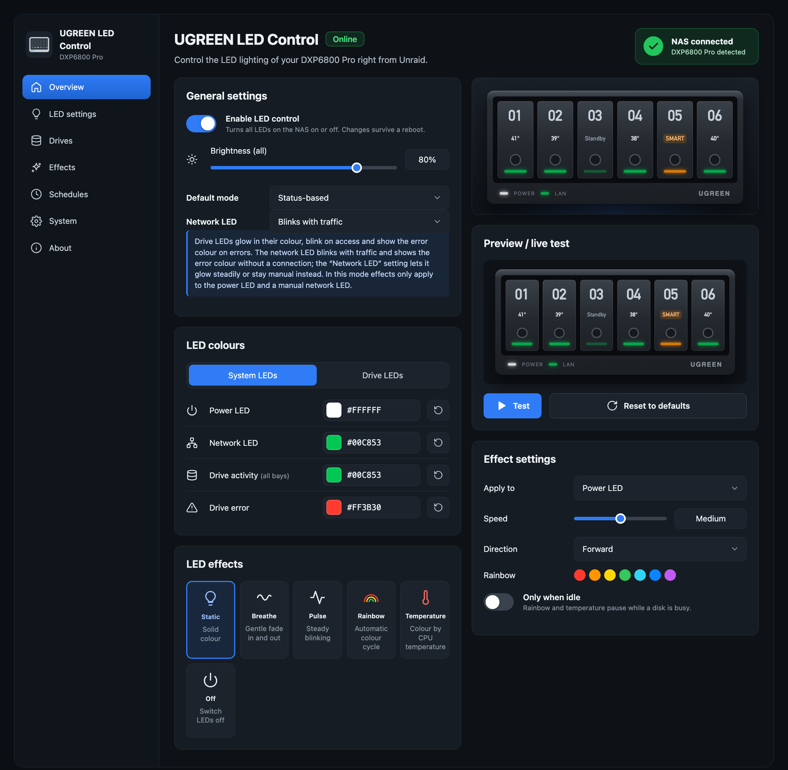
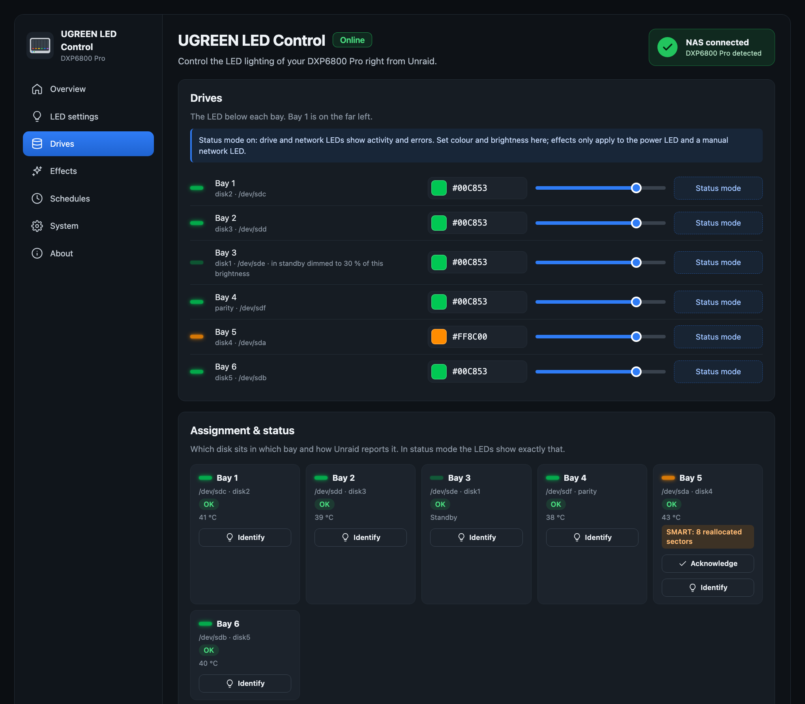
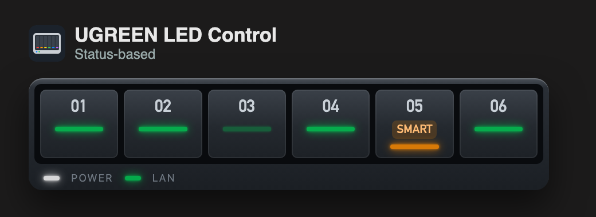
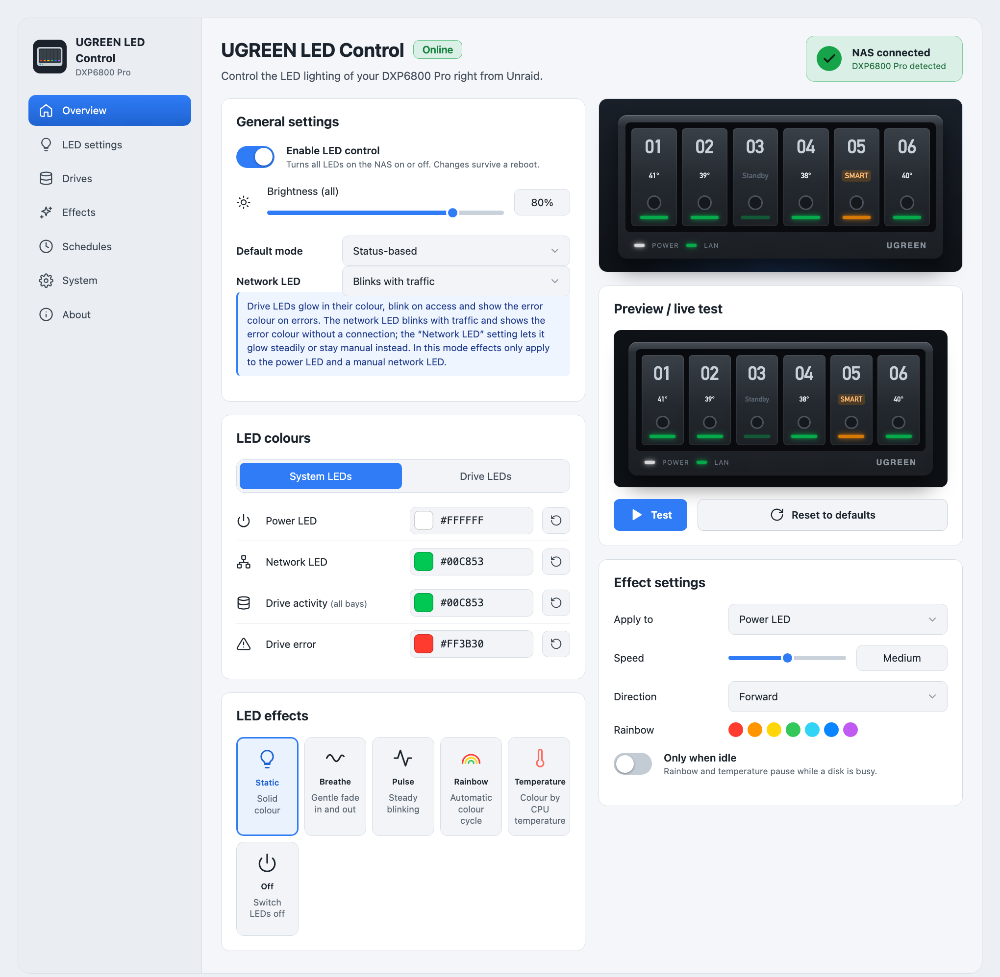

# UGREEN LED Control for Unraid

LED control for UGREEN DX/DXP NAS devices on Unraid 7: colour, brightness and effect for every front LED, and a status mode that turns the bay and network LEDs into a live view of your array. Developed on a DXP6800 Pro, confirmed by users on the DXP4800 family and the DXP8800 Plus.



## Features

- **Per LED**: colour, brightness and effect – static, breathe and pulse (run by the LED controller), rainbow and CPU temperature (run by the plugin, with speed, direction and "only when idle")
- **Status mode**: bay LEDs blink on disk activity, show an error colour for disabled or missing disks, warn on rising SMART values (with an "Acknowledge" button), breathe during parity checks and rebuilds, and dim, switch off or pulse slowly for spun-down disks. Each bay can show its disk's temperature colour, based on Unraid's warning and critical limits
- **Network LED**: blinks with traffic, shows only the link, or stays manual
- **Night mode**: dim or switch off at fixed times, also across midnight
- **Unraid alerts**: the power LED blinks while there are unread warnings or alerts
- **Identify a bay**: blink one bay white before you pull a disk
- **Dashboard tile**: the live LEDs of every bay in a compact tile, optionally with temperatures
- **Interface**: English, German and Spanish; dark, light or "same as Unraid"; every setting saves on change and survives a reboot
- It never wakes sleeping disks and needs no kernel module



<p>
  
  
</p>

The screenshots show the interface with sample data of a DXP6800 Pro.

## Support

Questions and problems: the [support thread in the Unraid forum](https://forums.unraid.net/topic/200791-plugin-ugreen-led-control-led-control-for-ugreen-dxdxp-nas/). Bug reports and feature requests are also welcome as [GitHub issues](https://github.com/alexanderschubert/ugreen-led-control/issues). Please include your NAS model, the Unraid and plugin versions and the output of:

```
/usr/local/emhttp/plugins/ugreen-led-control/backend/ugreen-led-ctl status
/usr/local/emhttp/plugins/ugreen-led-control/backend/ugreen-led-ctl smbus
/usr/local/emhttp/plugins/ugreen-led-control/backend/ugreen-led-i2c probe
```

## Supported models

The LED controller (I2C address 0x3a on the SMBus I801 adapter) is the same across UGREEN's DX/DXP series. Bays are matched to disks by SATA port, after [miskcoo/ugreen_leds_controller](https://github.com/miskcoo/ugreen_leds_controller):

| Model | Bays → SATA ports | Assignment |
|---|---|---|
| DXP6800 Pro | ata3, ata4, ata5, ata6, ata1, ata2 | verified (developed on it) |
| DXP8800 Plus | ata1 … ata8 | verified by miskcoo, confirmed by users |
| DXP4800 / Plus / Pro | ata1 … ata4 | confirmed by users |
| DX4600 Pro | ata1 … ata4 | verified by miskcoo |
| DX4700, DXP2800 | ata1 … ataN | reported by users |
| other models | ata1 … ataN | guessed |

The System page shows which applies; "Identify" on the Drives page checks it. Not supported: DXP2800 V1.2 and the GT models, which miskcoo lists as experimental.

## Install

Unraid 7.0 or newer. Plugins → Install Plugin:

```
https://raw.githubusercontent.com/alexanderschubert/ugreen-led-control/main/plugin/ugreen-led-control.plg
```

The settings page is at Settings → UGREEN LED Control. If you use the `ugreenleds-driver` plugin, uninstall it first: both would write the same LEDs. The plugin is submitted to Community Applications.

## How it works

- `i2c/` – `ugreen-led-i2c`, a static Go tool that talks to the LED controller (address 0x3a on the "SMBus I801 adapter") through `/dev/i2c-N`. No kernel module, so new Unraid kernels keep working. Protocol after [miskcoo/ugreen_leds_controller](https://github.com/miskcoo/ugreen_leds_controller).
- `src/backend/ugreen-led-ctl` – settings (`apply`), bay mapping (`bays`) and the status daemon, on top of `ugreen-led-i2c`.
- `src/web/api.php` is the JSON API for the settings page; writes need the WebGUI `csrf_token`.

## Development

Copy the working tree onto the running system without a release. It needs `build/ugreen-led-i2c` (the CI artifact of the "I2C tool" workflow, e.g. `gh run download <id> -n ugreen-led-i2c -D build`):

```
bash scripts/install-dev.sh
```

## Translations

The interface texts are in `src/web/js/i18n.js`, one block per language (`de`, `en`, `es`). Missing texts show in English.

```
python3 scripts/i18n.py export en > en.json   # all English texts as a template
python3 scripts/i18n.py check                 # same keys, {placeholders} and HTML as English (CI runs this)
```

To add or improve a language: translate only the values, keep `{placeholders}` and HTML tags as they are, and open a pull request or post the JSON in an issue. Spanish: ivolution.

## Release

1. Bump `version` and `CHANGES` in `plugin/ugreen-led-control.plg`.
2. Update the MD5 of every download in the `.plg` with the binary of the pull request's CI run (`python3 scripts/plg-hashes.py plugin/ugreen-led-control.plg --binary ugreen-led-i2c=build/ugreen-led-i2c`); CI fails on stale hashes.
3. Merge to `main`. The `Tag release` workflow creates the tag `v<version>` and a release with the `ugreen-led-i2c` binary.

The plugin downloads its files from that tag and the binary from the release. Wait for the workflow to finish (about a minute) before updating in Unraid; an update attempted earlier can leave GitHub caching a 404 for up to five minutes.

## Community Applications

`ca_profile.xml` and `plugins/ugreen-led-control.xml` are the Community Applications listing (author profile and plugin entry). The `<PluginURL>` in the listing must stay identical to the `pluginURL` of `plugin/ugreen-led-control.plg`.

## License

MIT.
